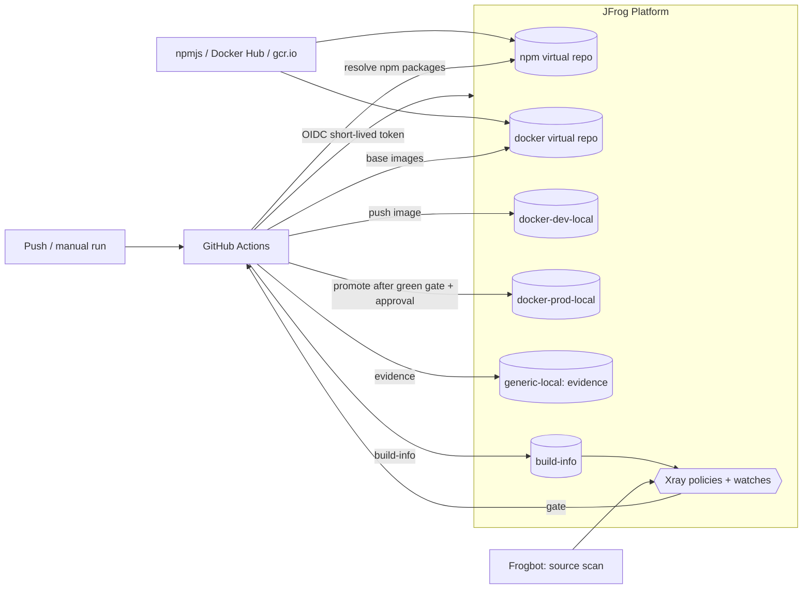

# OWASP Juice Shop – Secure Supply Chain Pipeline (GitHub Actions + JFrog Platform)

A CI/CD pipeline that builds [OWASP Juice Shop](https://github.com/juice-shop/juice-shop) (Node.js / TypeScript) into a
hardened Docker image. All dependencies come through JFrog Artifactory, every build is scanned by JFrog Xray, and an image
is only promoted to the production repository after it has passed the security gate.

**Stack:** GitHub Actions · JFrog Artifactory · JFrog Xray · JFrog CLI · Frogbot · Docker · Kubernetes

## What the pipeline does



| Stage | What happens |
|---|---|
| **Authenticate** | `jfrog/setup-jfrog-cli` exchanges the GitHub OIDC token for a short-lived JFrog token. No long-lived secrets are stored for the pipeline. |
| **Resolve dependencies** | npm is pointed at the Artifactory virtual repo `juice-npm-virtual` (`.npmrc` is generated at runtime). |
| **Compile** | `jf npm install --ignore-scripts` installs all dependencies and records them in the build-info, then `npm run build:server` compiles the TypeScript server. The repository has no `package-lock.json`, so `npm install` is used instead of `npm ci`. `--ignore-scripts` skips the `postinstall` hook; the frontend is built inside the Docker build instead. |
| **Test** | `npm run test:server` runs the project's existing server unit tests. |
| **Package** | Multi-stage `docker build`. Base images are pulled from `juice-docker-virtual`, npm packages from `juice-npm-virtual`. The registry credentials are passed as a BuildKit secret and never end up in an image layer. The runtime image is distroless and runs as user `65532`. |
| **Publish** | `jf docker push` to `juice-docker-dev-local`, tagged with the commit SHA (no `latest`). Build-info is published with `jf rt bce` / `bag` / `bp`. |
| **Security gate** | `jf build-scan --fail=true`: the run fails when Xray reports a policy violation (Critical severity blocks). |
| **Evidence** | `scripts/export-xray-evidence.sh` exports the Xray scan result (`xray-scan.json`) and a CycloneDX SBOM (`sbom-cyclonedx.json`). Both are validated, stored in `juice-generic-local/juice-shop/<tag>/` and attached to the run as a GitHub artifact. This step also runs when the gate is red. |
| **Promote** | After a green gate and a manual approval (GitHub environment `production`), `jf rt build-promote` copies the build from `juice-docker-dev-local` to `juice-docker-prod-local`. The image is promoted, not rebuilt. |

## Repository layout

| Path | Purpose |
|---|---|
| `.github/workflows/secure-pipeline.yml` | Main pipeline: compile → test → package → scan gate → evidence → promote |
| `.github/workflows/frogbot-scan-pull-request.yml` | Frogbot scan of the dependencies changed in a pull request |
| `.github/workflows/frogbot-scan-repository.yml` | Frogbot scan of the default branch (manual / nightly) |
| `Dockerfile` | Multi-stage build, upstream hardening steps kept, dependencies only via Artifactory |
| `deploy/k8s/deployment.yaml`, `service.yaml` | Kubernetes Deployment (non-root, probes, resource limits) and Service |
| `scripts/bootstrap-jfrog-repos.sh` | Creates the Artifactory repositories (bash) |
| `scripts/preflight-check.sh` | Checks local tools, Docker/BuildKit and the JFrog connection (bash) |
| `scripts/export-xray-evidence.sh` | Exports and validates the Xray scan and the CycloneDX SBOM |
| `scripts/windows/*.ps1` | PowerShell versions of the bootstrap and preflight scripts |

## Artifactory repositories

| Repository | Type | Purpose |
|---|---|---|
| `juice-npm-remote` | remote | proxy for npmjs |
| `juice-npm-local` | local | internal npm packages |
| `juice-npm-virtual` | virtual | single resolution URL for npm (local + remote) |
| `juice-docker-remote` | remote | proxy for Docker Hub (`node` base image) |
| `juice-gcr-remote` | remote | proxy for `gcr.io` (distroless runtime image) |
| `juice-docker-dev-local` | local | images from CI, before promotion |
| `juice-docker-prod-local` | local | promoted images only |
| `juice-docker-virtual` | virtual | single resolution URL for Docker (remotes + local repos) |
| `juice-generic-local` | local | evidence: Xray scan export and SBOM per image tag |

## Prerequisites

**Accounts**

- GitHub repository (fork of Juice Shop) with Actions enabled
- JFrog Platform (SaaS) with Artifactory and Xray; admin access for the initial setup

**Local tools**

| Tool | Note |
|---|---|
| Git, Docker (>= 23, BuildKit) | Docker needs about 15 GB free disk |
| Node.js + npm | version from `engines` in `package.json` (CI uses Node 22) |
| JFrog CLI (`jf`) v2 | |
| `curl`, `unzip`, `jq` | used by the bash scripts |
| `kubectl` + a local cluster | Docker Desktop Kubernetes, kind or minikube, only for the Kubernetes test |

Windows works natively with the PowerShell scripts in `scripts/windows/` (or via WSL2 with the bash scripts).
On Apple Silicon add `--platform linux/amd64` when running the CI-built image.

## Setup

1. **JFrog CLI:** `jf c add <server-id> --url https://<JF_HOST> --access-token <admin-token>`, then verify with `jf rt ping`.
2. **Repositories:** run `./scripts/bootstrap-jfrog-repos.sh` (bash) or `.\scripts\windows\bootstrap-jfrog-repos.ps1` (PowerShell).
3. **OIDC integration:** JFrog UI → Administration → General → Manage Integrations → OIDC. Provider name `github-oidc`,
   provider URL `https://token.actions.githubusercontent.com`, plus an identity mapping for the GitHub repository with
   permissions to resolve npm and Docker, deploy to `juice-docker-dev-local` and `juice-generic-local`, read Xray results and promote builds.
4. **GitHub settings** (Settings → Secrets and variables → Actions):
   - variable `JF_HOST` – host name without scheme, e.g. `mycompany.jfrog.io`
   - environment `production` with a required reviewer (promotion approval)
   - for Frogbot: secret `JF_ACCESS_TOKEN` and environment `frogbot`
5. **Xray:** index `juice-docker-dev-local`, `juice-docker-prod-local`, `juice-npm-remote` and the build; create a
   Security Policy (Critical → fail build) and a Watch covering the docker repository and the build.
6. Optional check of the local setup: `./scripts/preflight-check.sh <JF_HOST>` or `.\scripts\windows\preflight-check.ps1 -JfHost <JF_HOST>`.

## Running the pipeline

- **Automatically** on every push (documentation-only changes are ignored), or **manually** under
  *Actions → secure-pipeline → Run workflow*.
- Input `enforce_gate` (`true` by default): with `false` the build continues despite policy violations. This is meant for
  comparing runs with and without the gate.
- Only one run per branch is active at a time; a newer push cancels the older run.
- Results: build-info under *Application → Builds* in JFrog, Xray results on the build and the image, evidence in
  `juice-generic-local/juice-shop/<commit-sha>/` and as the GitHub artifact `evidence-<commit-sha>`.

Juice Shop is intentionally vulnerable, so the gate fails on the unmodified code. A run turns green once the blocking
findings are fixed (dependency upgrade) or covered by a documented, time-boxed Xray ignore rule.

## Evidence files

| File | Content |
|---|---|
| `xray-scan.json` | Xray scan result of the image: vulnerabilities and policy violations |
| `sbom-cyclonedx.json` | CycloneDX (JSON) software bill of materials of the image |

Quick check of a downloaded SBOM:

```bash
jq '{bomFormat, specVersion, components: (.components | length)}' sbom-cyclonedx.json
```
```powershell
Get-Content .\sbom-cyclonedx.json -Raw | ConvertFrom-Json | Select-Object bomFormat, specVersion, @{n='components';e={$_.components.Count}}
```

Download the evidence of a run with `gh run download <run-id> -n evidence-<commit-sha>`.

## Running the image

```bash
# from an exported archive
docker load -i juice-shop.tar.gz
docker run --rm -p 3000:3000 <image-name-shown-by-docker-load>      # http://localhost:3000

# from Artifactory (promoted image)
docker login <JF_HOST>
docker run --rm -p 3000:3000 <JF_HOST>/juice-docker-prod-local/juice-shop:<commit-sha>
```

Create the archive (for example for offline use):

```bash
docker save -o juice-shop.tar <JF_HOST>/juice-docker-prod-local/juice-shop:<commit-sha>
gzip juice-shop.tar            # Windows: tar -czf juice-shop.tar.gz juice-shop.tar
```

### Kubernetes

The manifests in `deploy/k8s/` contain the placeholder `REPLACE_ME/juice-docker-prod-local/juice-shop:REPLACE_TAG`.
Set the image, then apply:

```bash
# local cluster (Docker Desktop / kind / minikube): use the locally available image
docker tag <JF_HOST>/juice-docker-prod-local/juice-shop:<commit-sha> juice-shop:local
# kind only:  kind load docker-image juice-shop:local
sed -i 's#image: .*#image: juice-shop:local#' deploy/k8s/deployment.yaml   # PowerShell: edit the image line manually

kubectl apply -f deploy/k8s/
kubectl rollout status deployment/juice-shop
kubectl port-forward svc/juice-shop 3000:80                                # http://localhost:3000
```

To pull straight from Artifactory, create a pull secret and enable `imagePullSecrets` in the Deployment:

```bash
kubectl create secret docker-registry artifactory-pull --docker-server=<JF_HOST> \
  --docker-username=<user> --docker-password=<token>
```

## Scan results

The first scans of the unmodified application block the gate with **9 Critical violations**, among them:

| Component | Version | Issue | Fix available |
|---|---|---|---|
| `jsonwebtoken` | 0.4.0 / 0.1.0 | CVE-2015-9235 (CVSS 9.8, token signature bypass) | 4.2.2 or later (current major: 9.x) |
| `express-jwt` | 0.1.3 | CVE-2020-15084 (authorization bypass) | 6.0.0 or later |
| `lodash` | 2.4.2 | CVE-2019-10744 (prototype pollution) | 4.17.12 or later |
| `crypto-js` | 3.3.0 | see the Xray violation | see Xray |
| `decompress` | 4.2.1 | see the Xray violation | no fixed version |
| `marsdb` | 0.6.11 | see the Xray violation | no fixed version |

The image scan additionally reports OS packages of the distroless base layer.

## Frogbot

Two workflows run [Frogbot](https://github.com/jfrog/frogbot) against the source code:

- **Pull request scan** (`frogbot-scan-pull-request.yml`) – scans the dependencies changed by a pull request and comments the result on it. Runs in the `frogbot` environment.
- **Repository scan** (`frogbot-scan-repository.yml`) – scans the default branch (`master`) on demand and nightly; findings are reported as pull requests with fixes.

Source scanning (Frogbot) and image scanning (Xray) complement each other: Frogbot evaluates declared dependencies at commit time, including
development dependencies; Xray evaluates what is actually inside the image (application files, runtime, OS packages) before it is promoted.

## Limitations

- Juice Shop is intentionally vulnerable; findings are expected.
- Ignore rules used to get a green run must be time-boxed and carry a justification.
- Only the server unit tests run in the pipeline; the browser-based frontend and API test suites need a running application and are not part of it.
- The Xray export API only returns data once the image has been indexed; the export step retries for up to 10 minutes.
