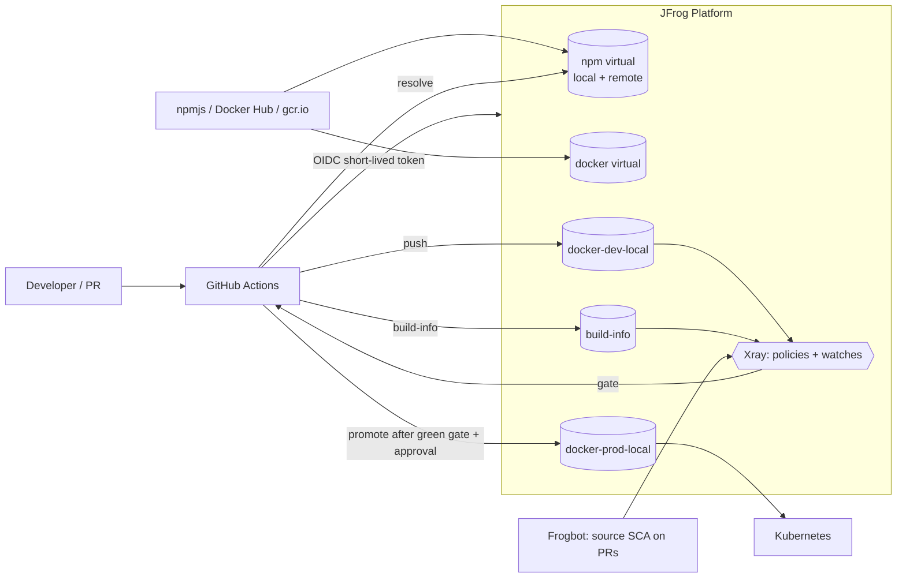

# Secure Software Supply Chain Pipeline – OWASP Juice Shop on the JFrog Platform

DevSecOps reference pipeline for building, securing and releasing a Docker-based application.
Fork of [OWASP Juice Shop](https://github.com/juice-shop/juice-shop) (Node.js/TypeScript) – chosen because it
is intentionally vulnerable, which makes the security controls visible.

**Stack:** GitHub Actions · JFrog Artifactory · JFrog Xray (+ Curation, Frogbot) · JFrog CLI · Docker · Kubernetes

## Architecture



## Repository layout

| Path | Purpose |
|---|---|
| `.github/workflows/secure-pipeline.yml` | CI pipeline (compile → test → package → scan gate → evidence → promote) |
| `.github/workflows/frogbot-*.yml` | Source-code SCA with Frogbot (PR + repository scan) |
| `Dockerfile` | Multi-stage build; base images and npm packages only via Artifactory; distroless, non-root runtime |
| `deploy/k8s/*.yaml` | Kubernetes Deployment + Service |
| `scripts/bootstrap-jfrog-repos.sh` | Creates the Artifactory repository layout |
| `scripts/windows/*.ps1` | PowerShell versions of the bootstrap and preflight scripts (native Windows) |
| `scripts/preflight-check.sh` | Checks local tools, Docker/BuildKit, JFrog connection and repositories |
| `scripts/export-xray-evidence.sh` | Exports Xray scan (JSON) and CycloneDX SBOM |

## How the assignment requirements are covered

| Requirement | Implementation |
|---|---|
| CI tool | GitHub Actions |
| Compile / test / package | `jf npm ci` (+ build) → `npm run test:server` (existing tests) → `docker build` |
| Repository best practices | local/remote/virtual per package type, stage-based docker repos (dev → prod), naming convention, unique immutable tags (commit SHA), least-privilege CI identity, `generic` repo for evidence |
| Secure dependency resolution | npm and Docker base images resolved **only** through Artifactory virtual repos; `package-lock.json` + `npm ci`; OIDC short-lived tokens instead of stored secrets; BuildKit secret keeps credentials out of image layers; Curation can block malicious packages at the gate |
| Quality gates | (1) compile/test, (2) Xray build scan `jf build-scan --fail` with security + license policy, (3) Xray watch on the docker repo, (4) promotion to prod only after a green scan **and** manual approval (GitHub environment) |
| Traceability / auditability | Build-info (commit, dependencies, artifacts, env), image labelled with commit SHA, build promoted (not rebuilt), SBOM + scan export stored per tag in Artifactory |
| Xray scan on docker repo | Docker repos are indexed; watch + policy attached |
| SBOM (CycloneDX) | Exported via Xray API in the pipeline → `evidence/sbom-cyclonedx` |
| Frogbot (optional) | PR scan + repository scan workflows |

## Prerequisites

**Accounts and access**

| Item | Details |
|---|---|
| GitHub account | Public fork of Juice Shop. **Enable Actions on the fork** (disabled by default on forks, also scheduled workflows). Environments (`production`, `frogbot`) and repository variables/secrets must be available |
| JFrog Platform (trial, SaaS) | Admin rights. Artifactory + Xray required; Curation, Advanced Security (contextual analysis), Evidence are optional, depending on the trial |
| Admin access token | For `jf c add` and the bootstrap script (not stored in the repo) |
| OIDC integration | Created once in the JFrog UI (see Setup), replaces stored credentials |

**Local tools**

| Tool | Version / note |
|---|---|
| Git | any recent version |
| Docker | Engine/Desktop >= 23 with BuildKit (needed for `--secret`); 15+ GB free disk, 8+ GB RAM |
| Node.js + npm | version from `engines` in Juice Shop's `package.json` |
| JFrog CLI (`jf`) | v2, recent |
| curl, unzip, jq | used by the scripts |
| kubectl + kind **or** minikube | for the Kubernetes deployment test |
| cyclonedx-cli | optional, SBOM validation |

Linux/macOS or Windows (PowerShell scripts in `scripts/windows/`, or WSL2 with the bash scripts). On Apple Silicon use `--platform linux/amd64` for the CI-built image.

**Network:** outbound HTTPS from GitHub-hosted runners to `<JF_HOST>`; local machine reaches `<JF_HOST>`, GitHub, npmjs and Docker Hub.

Run `./scripts/preflight-check.sh <JF_HOST>` to verify the local setup and the JFrog connection.

## Setup

1. **Fork** Juice Shop and copy these files into the fork.
2. **Create repositories:** `jf c add` (admin), then `./scripts/bootstrap-jfrog-repos.sh`.
3. **OIDC:** JFrog UI → Administration → General → Manage Integrations → OIDC integration for GitHub
   (provider name `github-oidc`) + identity mapping for this repository (permissions: deploy to `juice-docker-dev-local`,
   resolve npm/docker, read Xray, promote).
4. **GitHub settings:** repository variable `JF_HOST` (e.g. `mycompany.jfrog.io`); secret `JF_ACCESS_TOKEN`
   (for Frogbot); environments `production` (required reviewer) and `frogbot`.
5. **Xray:** add `juice-docker-dev-local`, `juice-docker-prod-local`, `juice-npm-remote` and the build to indexed
   resources; create a *Security Policy* (Critical → fail build + block download) and a *License Policy*;
   create Watches for the docker repo and the build.
6. Run the workflow (`Actions → secure-pipeline → Run workflow`).

## Running the pipeline

- Push to any branch or trigger manually. `enforce_gate=false` lets a build continue despite violations
  (used only to compare gate-on vs gate-off in the demo).
- Because Juice Shop is intentionally vulnerable, the first run **fails the gate by design**. A documented
  remediation (dependency upgrade) or a time-boxed Xray ignore rule with justification turns the run green.

## Running the image

```bash
# from the exported archive
docker load -i juice-shop.tar.gz
docker run --rm -p 3000:3000 juice-shop:<tag>      # http://localhost:3000

# from Artifactory (needs access)
docker login <JF_HOST>
docker run --rm -p 3000:3000 <JF_HOST>/juice-docker-prod-local/juice-shop:<tag>

# Kubernetes (kind example)
kind load docker-image juice-shop:<tag>
# edit image in deploy/k8s/deployment.yaml first
kubectl apply -f deploy/k8s/
kubectl port-forward svc/juice-shop 3000:80
```

## Findings and remediation

<!-- TODO after first scan: fill in -->
**Most risky finding:** `<component / CVE>`
- **Why it is the highest risk:** severity, exploitability (known exploit / KEV), applicability, exposure, fix availability
- **Remediation:** fixed version / replacement / mitigation, rebuild, re-scan, evidence of the green run

## Source scan (Frogbot) vs. image scan (Xray)

<!-- TODO after both scans: fill in counts and the 3 groups -->
| | Frogbot (source) | Xray (docker image) |
|---|---|---|
| Scope | manifests/lockfile, direct + transitive dependencies | all image layers: OS packages, runtime, application files |
| Moment | pull request / commit (shift left) | after build, before promotion/deploy |
| Findings | `<n>` | `<n>` |
| Only here | e.g. dev dependencies that are not shipped | e.g. OS / runtime findings |

Both are needed: Frogbot gives developers early, fixable feedback; the image scan gates what is actually shipped.

## Known limitations

- Juice Shop is intentionally vulnerable – findings are expected and used to demonstrate the controls.
- The Xray ignore rule used for the green run is for demo purposes and must be time-boxed in real life.
- The frontend test suite (browser based) is not part of the pipeline for runtime reasons; server tests run.
