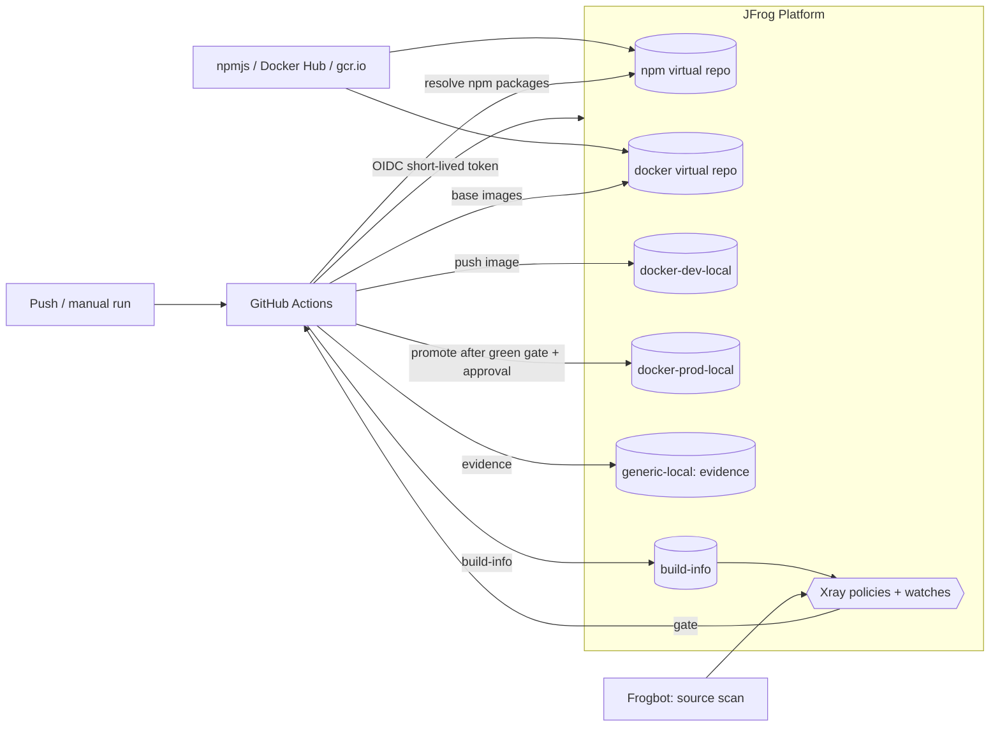

# OWASP Juice Shop – Secure Supply Chain Pipeline (GitHub Actions + JFrog Platform)

A CI/CD pipeline that builds [OWASP Juice Shop](https://github.com/juice-shop/juice-shop) (Node.js / TypeScript) into a
hardened Docker image. All dependencies come through JFrog Artifactory, every build is scanned by JFrog Xray, and an image
is only promoted to the production repository after it has passed the security gate.

**Stack:** GitHub Actions · JFrog Artifactory · JFrog Xray · JFrog CLI · Frogbot · Docker · Kubernetes

## What the pipeline does



| Stage | What happens |
|---|---|
| **Authenticate** | `jfrog/setup-jfrog-cli` exchanges the GitHub OIDC token for a short-lived JFrog token. No long-lived secrets are stored for the pipeline. |
| **Resolve dependencies** | npm is pointed at the Artifactory virtual repo `juice-npm-virtual` (`.npmrc` is generated at runtime). |
| **Compile** | `jf npm install --ignore-scripts` installs all dependencies and records them in the build-info, then `npm run build:server` compiles the TypeScript server. The repository has no `package-lock.json`, so `npm install` is used instead of `npm ci`. `--ignore-scripts` skips the `postinstall` hook; the frontend is built inside the Docker build instead. |
| **Test** | `npm run test:server` runs the project's existing server unit tests. |
| **Package** | Multi-stage `docker build`. Base images are pulled from `juice-docker-virtual`, npm packages from `juice-npm-virtual`. The registry credentials are passed as a BuildKit secret and never end up in an image layer. The runtime image is distroless and runs as user `65532`. |
| **Publish** | `jf docker push` to `juice-docker-dev-local`, tagged with the commit SHA (no `latest`). Build-info (npm dependencies + image) is published once with `jf rt bce` / `bag` / `bp`; the automatic publish of `setup-jfrog-cli` is disabled so later steps can't overwrite it. |
| **Security gate** | `jf build-scan --fail=true`: the run fails when Xray reports a policy violation (Critical severity blocks). |
| **Evidence** | `scripts/export-xray-evidence.sh` exports the Xray scan result (`xray-scan.json`) and a CycloneDX SBOM (`sbom-cyclonedx.json`). Both are validated, stored in `juice-generic-local/juice-shop/<tag>/` and attached to the run as a GitHub artifact. This step also runs when the gate is red. |
| **Promote** | After a green gate and a manual approval (GitHub environment `production`), `jf rt build-promote` copies the build from `juice-docker-dev-local` to `juice-docker-prod-local`. The image is promoted, not rebuilt. |

## Repository layout

| Path | Purpose |
|---|---|
| `.github/workflows/secure-pipeline.yml` | Main pipeline: compile → test → package → scan gate → evidence → promote |
| `.github/workflows/frogbot-scan-pull-request.yml` | Frogbot scan of the dependencies changed in a pull request |
| `.github/workflows/frogbot-scan-repository.yml` | Frogbot scan of the default branch (manual / nightly) |
| `Dockerfile` | Multi-stage build, upstream hardening steps kept, dependencies only via Artifactory |
| `deploy/k8s/deployment.yaml`, `service.yaml` | Kubernetes Deployment (non-root, probes, resource limits) and Service |
| `scripts/bootstrap-jfrog-repos.sh` | Creates the Artifactory repositories (bash) |
| `scripts/preflight-check.sh` | Checks local tools, Docker/BuildKit and the JFrog connection (bash) |
| `scripts/export-xray-evidence.sh` | Exports and validates the Xray scan and the CycloneDX SBOM |
| `scripts/windows/*.ps1` | PowerShell versions of the bootstrap and preflight scripts |

## Artifactory repositories

| Repository | Type | Purpose |
|---|---|---|
| `juice-npm-remote` | remote | proxy for npmjs |
| `juice-npm-local` | local | internal npm packages |
| `juice-npm-virtual` | virtual | single resolution URL for npm (local + remote) |
| `juice-docker-remote` | remote | proxy for Docker Hub (`node` base image) |
| `juice-gcr-remote` | remote | proxy for `gcr.io` (distroless runtime image) |
| `juice-docker-dev-local` | local | images from CI, before promotion |
| `juice-docker-prod-local` | local | promoted images only |
| `juice-docker-virtual` | virtual | single resolution URL for Docker (remotes + local repos) |
| `juice-generic-local` | local | evidence: Xray scan export and SBOM per image tag |

## Prerequisites

**Accounts**

- GitHub repository (fork of Juice Shop) with Actions enabled
- JFrog Platform (SaaS) with Artifactory and Xray; admin access for the initial setup

**Local tools**

| Tool | Note |
|---|---|
| Git, Docker (>= 23, BuildKit) | Docker needs about 15 GB free disk |
| Node.js + npm | version from `engines` in `package.json` (CI uses Node 22) |
| JFrog CLI (`jf`) v2 | |
| `curl`, `unzip`, `jq` | used by the bash scripts |
| `kubectl` + a local cluster | Docker Desktop Kubernetes, kind or minikube, only for the Kubernetes test |

Windows works natively with the PowerShell scripts in `scripts/windows/` (or via WSL2 with the bash scripts).
On Apple Silicon add `--platform linux/amd64` when running the CI-built image.

## Setup

1. **JFrog CLI:** `jf c add <server-id> --url https://<JF_HOST> --access-token <admin-token>`, then verify with `jf rt ping`.
2. **Repositories:** run `./scripts/bootstrap-jfrog-repos.sh` (bash) or `.\scripts\windows\bootstrap-jfrog-repos.ps1` (PowerShell).
3. **OIDC integration:** JFrog UI → Administration → General → Manage Integrations → OIDC. Provider name `github-oidc`,
   provider URL `https://token.actions.githubusercontent.com`, plus an identity mapping for the GitHub repository with
   permissions to resolve npm and Docker, deploy to `juice-docker-dev-local` and `juice-generic-local`, read Xray results and promote builds.
4. **GitHub settings** (Settings → Secrets and variables → Actions):
   - variable `JF_HOST` – host name without scheme, e.g. `mycompany.jfrog.io`
   - environment `production` with a required reviewer (promotion approval)
   - for Frogbot: secret `JF_ACCESS_TOKEN` and environment `frogbot`
5. **Xray:** index `juice-docker-dev-local`, `juice-docker-prod-local`, `juice-npm-remote` and the build; create a
   Security Policy (Critical → fail build) and a Watch covering the docker repository and the build.
6. Optional check of the local setup: `./scripts/preflight-check.sh <JF_HOST>` or `.\scripts\windows\preflight-check.ps1 -JfHost <JF_HOST>`.

## Running the pipeline

- **Automatically** on every push (documentation-only changes are ignored), or **manually** under
  *Actions → secure-pipeline → Run workflow*.
- Input `enforce_gate` (`true` by default): with `false` the build continues despite policy violations. This is meant for
  comparing runs with and without the gate.
- Only one run per branch is active at a time; a newer push cancels the older run.
- Results: build-info under *Application → Builds* in JFrog, Xray results on the build and the image, evidence in
  `juice-generic-local/juice-shop/<commit-sha>/` and as the GitHub artifact `evidence-<commit-sha>`.

Juice Shop is intentionally vulnerable, so the gate fails on the unmodified code. A run turns green once the blocking
findings are fixed (dependency upgrade) or covered by a documented, time-boxed Xray ignore rule.

**Branches**

| Branch | State |
|---|---|
| `master` | remediated version: gate green, image promoted to `juice-docker-prod-local` |
| `demo/vulnerable` | original Juice Shop dependencies: gate red, image download blocked by Xray (kept for comparison) |

## Evidence files

| File | Content |
|---|---|
| `xray-scan.json` | Xray scan result of the image: vulnerabilities and policy violations |
| `sbom-cyclonedx.json` | CycloneDX (JSON) software bill of materials of the image |

Quick check of a downloaded SBOM:

```bash
jq '{bomFormat, specVersion, components: (.components | length)}' sbom-cyclonedx.json
```
```powershell
Get-Content .\sbom-cyclonedx.json -Raw | ConvertFrom-Json | Select-Object bomFormat, specVersion, @{n='components';e={$_.components.Count}}
```

Download the evidence of a run with `gh run download <run-id> -n evidence-<commit-sha>`.

## Running the image

Released image (promoted from build #28, commit `cc00d3c`):

```
reyjtrial.jfrog.io/juice-docker-prod-local/juice-shop:cc00d3c3eb44c9e152462ecec62b6abe35f4b16b
```

From the archive (`juice-shop.tar.gz`, SHA256 `a22f537dcc5e1248223844bd0cb9b3068ec42e28b378e33a8082e21a528e1965`):

```bash
docker load -i juice-shop.tar.gz
docker run -d --name juice-shop -p 127.0.0.1:3000:3000 \
  reyjtrial.jfrog.io/juice-docker-prod-local/juice-shop:cc00d3c3eb44c9e152462ecec62b6abe35f4b16b
# http://localhost:3000
```

Binding to `127.0.0.1` keeps the (intentionally vulnerable) app off the local network.

From Artifactory (needs access to the instance):

```bash
docker login reyjtrial.jfrog.io
docker run -d --name juice-shop -p 127.0.0.1:3000:3000 \
  reyjtrial.jfrog.io/juice-docker-prod-local/juice-shop:cc00d3c3eb44c9e152462ecec62b6abe35f4b16b
```

Creating the archive: the output of `docker save` has to be gzipped directly (not wrapped in another tar):

```bash
docker save <image> | gzip > juice-shop.tar.gz
```
```powershell
docker save -o juice-shop.tar <image>
$in = [IO.File]::OpenRead("juice-shop.tar"); $out = [IO.File]::Create("juice-shop.tar.gz")
$gz = New-Object IO.Compression.GZipStream($out, [IO.Compression.CompressionLevel]::Optimal)
$in.CopyTo($gz); $gz.Dispose(); $out.Dispose(); $in.Dispose()
```

### Kubernetes

`deploy/k8s/deployment.yaml` references the released image with `imagePullPolicy: IfNotPresent`, so on a local cluster that shares
the Docker image store (Docker Desktop) the image loaded from the archive is used and no registry access is needed:

```bash
docker load -i juice-shop.tar.gz
kubectl apply -f deploy/k8s/
kubectl rollout status deployment/juice-shop
kubectl port-forward svc/juice-shop 3000:80            # http://localhost:3000
```

kind / minikube: load the image into the cluster first (`kind load docker-image <image>` / `minikube image load <image>`).
To pull directly from Artifactory instead, create a pull secret and enable `imagePullSecrets` in the Deployment:

```bash
kubectl create secret docker-registry artifactory-pull --docker-server=reyjtrial.jfrog.io \
  --docker-username=<user> --docker-password=<token>
```

## Scan results and remediation

### What Xray found

On the original code (branch `demo/vulnerable`) the gate failed with **9 Critical policy violations**. The scan also lists a lot of
High/Medium/Low findings in npm packages and in the Debian packages of the distroless base image. My policy only fails the build on
Critical, so those don't block, but they are in the scan export and the SBOM.

| Component | Version | Critical findings | Comes in via |
|---|---|---|---|
| `jsonwebtoken` | 0.4.0 | CVE-2015-9235 | direct dependency |
| `jsonwebtoken` | 0.1.0 | CVE-2015-9235 | `express-jwt` 0.1.3 |
| `express-jwt` | 0.1.3 | CVE-2020-15084 | direct dependency |
| `crypto-js` | 3.3.0 | CVE-2023-46233, CVE-2026-71851 | `pdfkit` 0.11 |
| `decompress` | 4.2.1 | CVE-2026-101894, CVE-2026-53486 | transitive |
| `lodash` | 2.4.2 | CVE-2019-10744 | `sanitize-html` 1.4.2 |
| `marsdb` | 0.6.11 | Xray advisory (no CVE) | direct dependency |

### The most risky one: jsonwebtoken / express-jwt

I picked the JWT libraries as the most risky finding. They all have a Critical score, but this one is the one that actually hurts:

- It sits in the login and authorization path. Every API call that needs a logged-in user goes through it.
- It's reachable from the internet without being logged in.
- The old versions accept tokens with `alg: none` and don't enforce the algorithm. So anyone can build their own token
  (e.g. as admin) and the server takes it. That's a full authentication bypass.
- Exploits are public, and fixed versions exist.

**What I changed** (`package.json`, `lib/insecurity.ts`):

- `jsonwebtoken` 0.4.0 → 9.x and `express-jwt` 0.1.3 → 8.x. That also removes the old `jsonwebtoken` 0.1.0 that came with express-jwt.
- The algorithm is now pinned to RS256, in express-jwt and in the app's own token check (`jws` 4.x API).
- The bundled RSA key is only 1024 bit, which jsonwebtoken 9 refuses by default. I allowed it for now (`allowInsecureKeySizes`)
  so the app keeps working. Rotating to a 2048-bit key is a follow-up.

**How I verified it**

- Juice Shop has unit tests for its own JWT attack challenges (unsigned token, token forged with the public key). Before, they
  checked that the attack works. After the upgrade the attacks are rejected, so I flipped 4 assertions to "attack is rejected".
  No new tests. All 419 server tests pass.
- Login in the running container still works.
- Next pipeline run: 9 → 6 Critical violations, all JWT findings gone.

### What I accepted for now

The other 6 violations come from 4 components. I didn't fix them here and created an Xray **ignore rule** per component version
instead, each with a reason and a 30-day expiry:

| Component | Why accepted |
|---|---|
| `decompress` 4.2.1 | no fixed version for these findings |
| `marsdb` 0.6.11 | no fixed version, project is abandoned |
| `lodash` 2.4.2 | comes with `sanitize-html` 1.4.2, which Juice Shop pins on purpose for a training challenge. Fix path: sanitize-html 2.x |
| `crypto-js` 3.3.0 | vulnerable code isn't reachable, see below |

`crypto-js` is a good example of "same score, different risk". Both findings are about weak randomness / weak PBKDF2 defaults.
Juice Shop doesn't use crypto-js itself; it only comes in through `pdfkit`, and pdfkit only calls the affected functions when a PDF is
encrypted with a password. The app creates its PDFs with `new PDFDocument()` and no password (`routes/order.ts`), so that code never runs.

An ignore rule doesn't hide anything. The vulnerabilities stay in the scan results, the export and the SBOM. The rule only stops
the enforcement (failing the build, blocking the download) for that exact component version, and it's logged and expires.
One rule per component means a new CVE in the same version would also be covered until the rule expires; per-CVE rules would be stricter.

With these rules in place the gate passes, the build is promoted after approval, and the image can be pulled from the prod repo.
The `demo/vulnerable` branch still has the old JWT libraries, so its gate stays red and its image stays blocked.

### Next steps with more time

- Rotate the JWT key to 2048 bit and move it out of the code.
- Replace `marsdb` and `decompress`, move to `sanitize-html` 2.x and `pdfkit` ≥ 0.13 (crypto-js 4.2), then remove the ignore rules.
- Gate on High findings with an available fix as well, not only Critical.

## Frogbot

Two workflows run [Frogbot](https://github.com/jfrog/frogbot) against the source code:

- **Pull request scan** (`frogbot-scan-pull-request.yml`) – scans the dependencies changed by a pull request and comments the result on it. Runs in the `frogbot` environment.
- **Repository scan** (`frogbot-scan-repository.yml`) – scans the default branch (`master`) on demand and nightly; findings are reported as pull requests with fixes.

Source scanning (Frogbot) and image scanning (Xray) complement each other: Frogbot evaluates declared dependencies at commit time, including
development dependencies; Xray evaluates what is actually inside the image (application files, runtime, OS packages) before it is promoted.

## Limitations

- Juice Shop is intentionally vulnerable; findings are expected.
- Only the server unit tests run in the pipeline; the browser-based frontend and API test suites need a running application and are not part of it.
- The Xray export API only returns data once the image has been indexed; the export step retries for up to 10 minutes.
