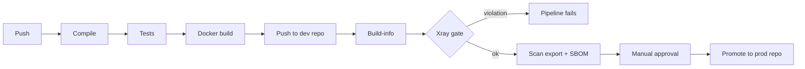

# OWASP Juice Shop – secure build pipeline with GitHub Actions and JFrog

This is a fork of [OWASP Juice Shop](https://github.com/juice-shop/juice-shop). I added a CI pipeline in GitHub Actions that
compiles and tests the app, packages it as a Docker image and runs it through the JFrog Platform (Artifactory and Xray).
Only images that pass the security checks and a manual approval end up in the production repository.

Juice Shop is intentionally vulnerable, so it's a good test object for this: the security checks have something to find.

## What the pipeline does

File: `.github/workflows/secure-pipeline.yml`. It runs on every push (not on README-only or deploy-file changes) and can be started manually.



1. **Login:** GitHub Actions logs in to JFrog with OIDC. There are no JFrog passwords or tokens stored in GitHub.
2. **Compile:** `jf npm install --ignore-scripts` installs the dependencies through Artifactory, then `npm run build:server` compiles the TypeScript server. A compile error stops the pipeline.
3. **Test:** `npm run test:server` runs the project's existing server unit tests. I didn't write tests.
4. **Package:** multi-stage `docker build`. Base images and npm packages come from Artifactory, the runtime image is distroless and runs as a non-root user.
5. **Publish:** the image is pushed to `juice-docker-dev-local`, tagged with the git commit SHA (never `latest`). Then the build-info is published.
6. **Quality gate:** `jf build-scan` asks Xray to scan the build. If a Critical vulnerability violates the policy, the pipeline fails here.
7. **Evidence:** the Xray scan data and a CycloneDX SBOM of the image are exported and stored (also when the gate fails).
8. **Promotion:** after a green gate, someone has to approve the GitHub environment `production`. Then the build is copied from `juice-docker-dev-local` to `juice-docker-prod-local`. The image is promoted, not rebuilt.

## Repository management in Artifactory

| Repository | Type | What it's for |
|---|---|---|
| `juice-npm-remote` | remote | proxy/cache for npmjs |
| `juice-npm-local` | local | internal npm packages |
| `juice-npm-virtual` | virtual | the one npm URL the build uses (local + remote) |
| `juice-docker-remote` | remote | proxy/cache for Docker Hub (`node` image) |
| `juice-gcr-remote` | remote | proxy/cache for gcr.io (distroless image) |
| `juice-docker-dev-local` | local | images from CI, before the gate/approval |
| `juice-docker-prod-local` | local | promoted images only |
| `juice-docker-virtual` | virtual | the one Docker URL the build uses |
| `juice-generic-local` | local | scan exports and SBOMs per image |

What I followed:
- local / remote / virtual per package type, and the build only talks to the virtual repos
- separate dev and prod repos, prod only gets images through promotion
- immutable tags (commit SHA), so every image points to exactly one commit
- Xray indexes the Docker repos and the builds

## Secure dependency resolution

- npm packages and base images are only pulled through Artifactory (`juice-npm-virtual`, `juice-docker-virtual`), in the pipeline and inside the Docker build.
- Authentication is OIDC with short-lived tokens. In the Docker build the npm token is passed as a BuildKit secret, so it never ends up in an image layer.
- `package-lock.json` (root and frontend) is committed, so every build installs exactly the same versions. Juice Shop doesn't ship lock files by default; I added them.

## Quality gates and traceability

Gates, in order: compile → tests → Xray gate → manual approval → promotion. On top of that, Xray blocks downloads of images
with violations, so a blocked image can't even be pulled.

What I can trace for every image:
- **Build-info** in Artifactory (Builds → `secure-pipeline`): git commit and branch, link to the GitHub run, all npm dependencies with checksums, the image layers, scan results and promotion history.
- **Image labels:** `org.opencontainers.image.revision` (commit) and `com.jfrog.build-number` (build).
- **Evidence:** scan export and SBOM stored per commit in `juice-generic-local/juice-shop/<commit-sha>/evidence/`, and as the GitHub run artifact `evidence-<commit-sha>`.

## Xray scan results

### What Xray found

On the original code the gate failed with **9 Critical policy violations**. The scan also lists a lot of High/Medium/Low
findings in npm packages and in the Debian packages of the base image. My policy only fails the build on Critical, so those
don't block, but they are in the scan export and the SBOM.

| Component | Version | Critical findings | Comes in via |
|---|---|---|---|
| `jsonwebtoken` | 0.4.0 | CVE-2015-9235 | direct dependency |
| `jsonwebtoken` | 0.1.0 | CVE-2015-9235 | `express-jwt` 0.1.3 |
| `express-jwt` | 0.1.3 | CVE-2020-15084 | direct dependency |
| `crypto-js` | 3.3.0 | CVE-2023-46233, CVE-2026-71851 | `pdfkit` 0.11 |
| `decompress` | 4.2.1 | CVE-2026-101894, CVE-2026-53486 | transitive |
| `lodash` | 2.4.2 | CVE-2019-10744 | `sanitize-html` 1.4.2 |
| `marsdb` | 0.6.11 | Xray advisory (no CVE) | direct dependency |

### The most risky one: jsonwebtoken / express-jwt

All of them have a Critical score, but this is the one that actually hurts:

- It sits in the login and authorization path. Every API call that needs a logged-in user goes through it.
- It's reachable from the internet without being logged in.
- The old versions accept tokens with `alg: none` and don't enforce the algorithm. So anyone can build their own token (e.g. as admin) and the server takes it. That's a full authentication bypass.
- Exploits are public, and fixed versions exist.

**How I fixed it** (`package.json`, `lib/insecurity.ts`):

- `jsonwebtoken` 0.4.0 → 9.x and `express-jwt` 0.1.3 → 8.x. That also removes the old `jsonwebtoken` 0.1.0 that came with express-jwt.
- The algorithm is now pinned to RS256, in express-jwt and in the app's own token check.
- The bundled RSA key is only 1024 bit, which jsonwebtoken 9 refuses by default. I allowed it for now so the app keeps working. Rotating to a 2048-bit key is the next step.

**How I checked it:**

- Juice Shop has unit tests for its own JWT attacks (unsigned token, token forged with the public key). Before, they checked that the attack works. After the upgrade the attacks are rejected, so I flipped those 4 assertions. No new tests. All server tests pass.
- Login in the running container still works.
- Next pipeline run: 9 → 6 Critical violations, all JWT findings gone.

### What I accepted for now

The other 6 violations come from 4 components. I didn't fix them here and created an Xray **ignore rule** per component
version instead, each with a reason and a 30-day expiry:

| Component | Why accepted |
|---|---|
| `decompress` 4.2.1 | no fixed version for these findings |
| `marsdb` 0.6.11 | no fixed version, project is abandoned |
| `lodash` 2.4.2 | comes with `sanitize-html` 1.4.2, which Juice Shop pins on purpose for a training challenge. Fix: sanitize-html 2.x |
| `crypto-js` 3.3.0 | the vulnerable code isn't reachable, see below |

`crypto-js` is a good example of "same score, different risk". Both findings are about weak randomness / weak PBKDF2 defaults.
Juice Shop doesn't use crypto-js itself. It only comes in through `pdfkit`, and pdfkit only calls those functions when a PDF
is encrypted with a password. The app creates its PDFs with `new PDFDocument()` and no password (`routes/order.ts`), so that code never runs.

An ignore rule doesn't hide anything. The vulnerabilities stay in the scan results, the export and the SBOM. The rule only
stops the enforcement (failing the build, blocking the download) for that exact component version, and it's logged and expires.

### Branches

| Branch | State |
|---|---|
| `master` | fixed version: gate green, image promoted to `juice-docker-prod-local` |
| `demo/vulnerable` | original dependencies: gate red, image download blocked by Xray |

## SBOM and scan export

The pipeline exports both for every image (`scripts/export-xray-evidence.sh`, Xray REST API):

| File | Content |
|---|---|
| `xray-scan.json` | Xray scan data of the image: all vulnerabilities (npm and OS packages) |
| `xray-violations.json` | policy violations of the image |
| `sbom-cyclonedx.json` | CycloneDX (JSON) SBOM of the image |

They are stored in `juice-generic-local/juice-shop/<commit-sha>/evidence/` and attached to the GitHub run. The files for the
released image are also attached to the release (see below).

## Frogbot: source scan vs. image scan

Frogbot scans the repository (`.github/workflows/frogbot-scan-repository.yml`, manual or nightly) and pull requests
(`frogbot-scan-pull-request.yml`). Results show up in the workflow log, in GitHub under Security → Code scanning and in JFrog
under Xray → Scans List → Git Repositories.

My first Frogbot run found nothing: 2 components, 0 vulnerabilities. Frogbot reads the dependencies from the lock file and
Juice Shop doesn't have one. After committing `package-lock.json` it found 2,195 components.

Compared with the Xray scan of the image built from the same commit:

| | Frogbot (source) | Xray (image) |
|---|---|---|
| Findings | 74 (5 Critical, 27 High) | 89 (6 Critical, 23 High) |
| Only found here | dev dependencies and frontend libraries (9 components). They aren't installed in the image, or only exist there as the compiled Angular bundle | Debian packages of the base image (28 findings) and a few nested npm packages |
| Found by both | 18 npm components that end up in the image, e.g. lodash, crypto-js, decompress, sanitize-html | |

So Frogbot looks at what the code declares and warns early, in the pull request. Xray looks at what is really inside the image
and decides what gets promoted. They complement each other.

## How to run it

### Run the image

The released image is build #__BUILD_NUMBER__, commit `__SHORT_SHA__`. The archive `juice-shop.tar.gz` is attached to the
[release](https://github.com/Reymund28593/juice-shop_RJJF/releases/tag/v1.0) (SHA256 `__ARCHIVE_SHA256__`).

```bash
docker load -i juice-shop.tar.gz
docker run -d --name juice-shop -p 127.0.0.1:3000:3000 reyjtrial.jfrog.io/juice-docker-prod-local/juice-shop:__IMAGE_TAG__
```

Then open http://localhost:3000. I bind to `127.0.0.1` on purpose: it's a vulnerable app and shouldn't be reachable from the network.

With access to the JFrog instance you can pull it directly instead: `docker login reyjtrial.jfrog.io` and the same `docker run`.

### Run it on Kubernetes

`deploy/k8s/deployment.yaml` and `service.yaml` use the released image with `imagePullPolicy: IfNotPresent`. On Docker Desktop
Kubernetes the image loaded from the archive is used directly, no registry access needed:

```bash
docker load -i juice-shop.tar.gz
kubectl apply -f deploy/k8s/
kubectl rollout status deployment/juice-shop
kubectl port-forward svc/juice-shop 3000:80
```

On kind or minikube load the image into the cluster first (`kind load docker-image ...` / `minikube image load ...`).

### Run the pipeline on your own JFrog instance

1. Create the repositories: `scripts/bootstrap-jfrog-repos.sh` (or `scripts/windows/bootstrap-jfrog-repos.ps1`), with a configured JFrog CLI (`jf c add`).
2. In JFrog, add an OIDC integration named `github-oidc` for GitHub (`https://token.actions.githubusercontent.com`) with an identity mapping for your repository.
3. In Xray, create a security policy (Critical → fail build, block download) and a watch on the Docker repos and the `secure-pipeline` build.
4. In GitHub, set the repository variable `JF_HOST` (e.g. `mycompany.jfrog.io`) and create the environments `production` (with a required reviewer) and `frogbot`.
5. Push to the repository or start the workflow under Actions → secure-pipeline → Run workflow.

`scripts/preflight-check.sh` checks the local tools and the JFrog connection.

## Files I added or changed

| Path | What |
|---|---|
| `.github/workflows/secure-pipeline.yml` | the pipeline |
| `.github/workflows/frogbot-scan-*.yml` | Frogbot repository and pull request scan |
| `Dockerfile` | multi-stage build, dependencies only via Artifactory |
| `deploy/k8s/` | Kubernetes Deployment and Service |
| `scripts/` | repo bootstrap, preflight check, scan/SBOM export |
| `package.json`, `lib/insecurity.ts`, `test/server/verify.unit.test.ts` | JWT fix |
| `package-lock.json`, `frontend/package-lock.json`, `.npmrc`, `.gitignore` | committed lock files |
